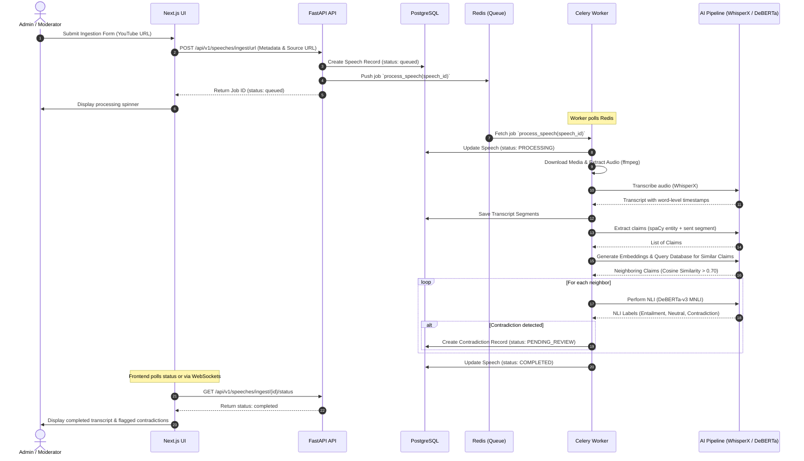
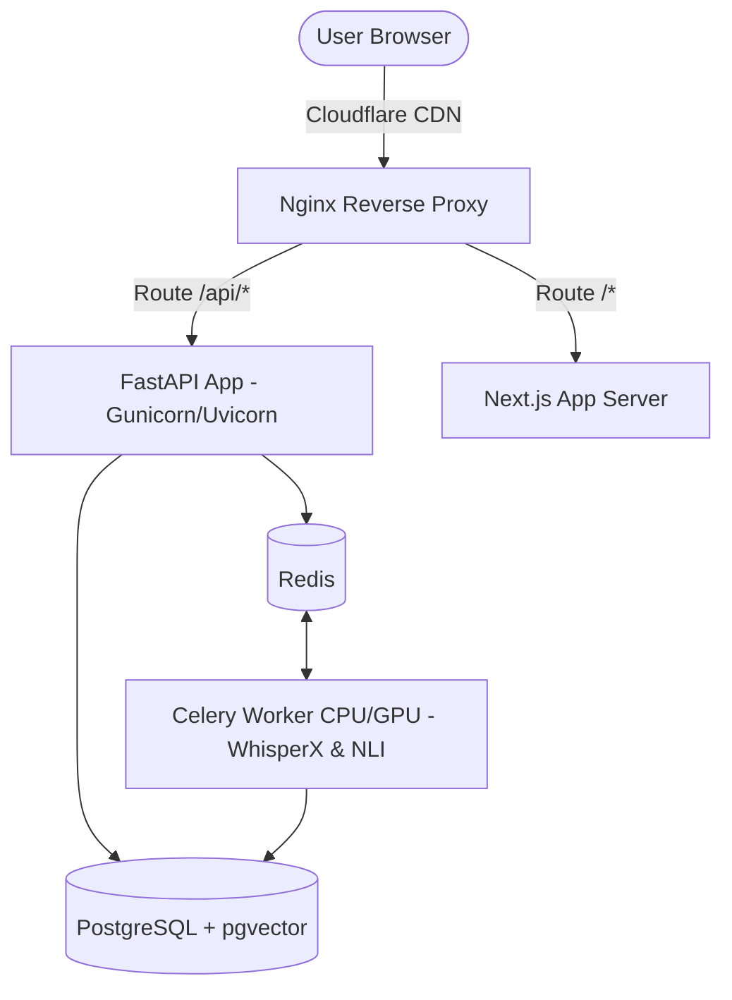
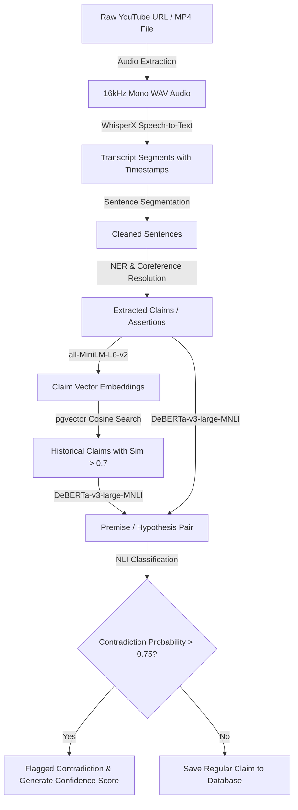

# AI Political Accountability & Statement Consistency Platform (MVP Foundation)

An open-source, evidence-first political statement registry mapping public assertions over time. Powered by Natural Language Inference (NLI) and semantic vector similarity search, the platform tracks statement consistency without accusing politicians of lying. It highlights discrepancies, details confidence metrics, and provides timestamped transcript links so users can review the evidence and form their own conclusions.

---

## 📖 Table of Contents
1. [Core Philosophy](#-core-philosophy)
2. [System Architecture](#-system-architecture)
3. [Technology Stack](#-technology-stack)
4. [Project Directory Structure](#-project-directory-structure)
5. [Database Schema](#-database-schema)
6. [AI & ML Pipeline Mechanics](#-aiml-pipeline-mechanics)
7. [API Endpoints Directory](#-api-endpoints-directory)
8. [Installation & Setup Guide](#-installation--setup-guide)
9. [Testing & Quality Assurance](#-testing--quality-assurance)
10. [Production & Scaling Considerations](#-production--scaling-considerations)

---

## ⚖️ Core Philosophy

This platform is built on several key engineering and editorial principles:
* **Evidence-First Design**: The system prioritizes neutral, verifiable citations. Statements are mapped directly to source audio or video segments with word-level timestamps.
* **Explainable AI**: Flagged inconsistencies feature clear explanations detailing the linguistic logic mismatches.
* **Neutrality & Civility**: The platform **never accuses politicians of lying** or calls statements "false." It matches statements by the same speaker and marks them as *semantically incompatible* based on logic rules, letting the audience make their own judgments.

---

## 🏗️ System Architecture

The platform uses a modular monolith backend and Celery workers to handle heavy machine learning operations.

### 1. Component Architecture
This diagram outlines the relationships between frontend views, backend modules, database layers, and background workers.

```mermaid
graph TD
    User([User / Journalist / Auditor]) -->|HTTPS| Frontend[Next.js 15 Web App]
    Frontend -->|REST APIs / JWT| API[FastAPI Gateway & Core Service]
    
    subgraph Core Backend [Backend Services]
        API --> Auth[Auth & RBAC Module]
        API --> Profiles[Politician Profiles Module]
        API --> Search[Hybrid Search Module]
        API --> Ingestion[Ingestion Controller]
        API --> Admin[Admin Moderation Module]
    end

    Ingestion -->|Publish Job| Redis[Redis Broker & Cache]
    Redis -->|Consume Job| Workers[Celery AI Workers]

    subgraph AI Pipeline [AI Worker Services]
        Workers --> Preprocess[Audio Extractor]
        Workers --> Transcribe[WhisperX Service]
        Workers --> ClaimExtractor[spaCy / HF Sentence Extractor]
        Workers --> Embedder[Sentence Transformer Embeddings]
        Workers --> NLIEngine[DeBERTa-v3 MNLI Classifier]
    end

    Core Backend -->|SQL / pgvector| PostgreSQL[(PostgreSQL DB)]
    Workers -->|Save Transcripts/Claims| PostgreSQL
```

### 2. Ingestion & Analysis Sequence
Shows the step-by-step processing lifecycle when a user submits a political debate or speech URL.



### 3. Deployment Topology
The system is built to deploy easily on standard environments and is pre-configured to utilize GPU worker nodes when available.



### 4. Data Processing Flow
Outlines how raw unstructured media files are transformed into verifiable, structured semantic inconsistency listings.



---

## 💻 Technology Stack

### Frontend
* **Core**: Next.js 15 (App Router), React, TypeScript
* **Styling**: Tailwind CSS, shadcn/ui components
* **State & Fetching**: Zustand (global client state), TanStack Query (server state & caching)
* **Animations**: Framer Motion
* **Icons**: Lucide React

### Backend
* **API Framework**: Python FastAPI
* **Database Mapping**: SQLAlchemy ORM, Alembic migrations
* **Task Queuing**: Celery, Redis (as broker & result backend)
* **Production Server**: Uvicorn / Gunicorn

### AI & Natural Language Processing (NLP)
* **Sentence Segmentation & NLP**: spaCy (`en_core_web_sm`)
* **Vector Embeddings**: Sentence-Transformers (`all-MiniLM-L6-v2` - 384 dimensions)
* **Natural Language Inference (NLI)**: Hugging Face pipelines (`cross-encoder/nli-deberta-v3-xsmall`)
* **Transcription Core**: Whisper / WhisperX ready

### Infrastructure
* **Containerization**: Docker, Docker Compose

---

## 📁 Project Directory Structure

```
authenticity/
├── docker-compose.yml          # Container configuration for all services
├── README.md                   # System documentation and setup guide
│
├── backend/                    # FastAPI App & Celery Worker
│   ├── Dockerfile
│   ├── requirements.txt        # Backend dependencies
│   ├── alembic/                # DB migrations folder
│   └── app/
│       ├── main.py             # FastAPI App bootstrap
│       ├── core/               # Configuration, security, DB connections
│       ├── models/             # SQLAlchemy DB schemas
│       ├── schemas/            # Pydantic validation structures
│       ├── routers/            # API Endpoints (Auth, Profiles, Search, Admin)
│       ├── worker/             # Celery application & worker task runners
│       └── tests/              # Pytest suites
│
└── frontend/                   # Next.js 15 App Router Frontend
    ├── package.json
    ├── tailwind.config.ts
    ├── tsconfig.json
    └── src/
        ├── app/                # Layouts, pages, route controllers
        ├── components/         # Reusable Tailwind / shadcn elements
        ├── lib/                # API fetch helpers
        ├── store/              # Zustand global client state
        └── types/              # TypeScript typings
```

---

## 🗄️ Database Schema

We use **PostgreSQL with the pgvector extension** to support both structured political data and semantic claim embeddings in a single database.

```sql
-- Core schemas summary
CREATE TABLE users (
    id UUID PRIMARY KEY DEFAULT uuid_generate_v4(),
    email VARCHAR(255) UNIQUE NOT NULL,
    hashed_password VARCHAR(255) NOT NULL,
    role VARCHAR(50) NOT NULL DEFAULT 'user' -- 'user', 'journalist', 'admin'
);

CREATE TABLE politicians (
    id UUID PRIMARY KEY DEFAULT uuid_generate_v4(),
    first_name VARCHAR(100) NOT NULL,
    last_name VARCHAR(100) NOT NULL,
    party VARCHAR(100) NOT NULL,
    current_office VARCHAR(255),
    bio TEXT,
    image_url VARCHAR(512)
);

CREATE TABLE speeches (
    id UUID PRIMARY KEY DEFAULT uuid_generate_v4(),
    politician_id UUID NOT NULL REFERENCES politicians(id) ON DELETE CASCADE,
    title VARCHAR(512) NOT NULL,
    source_url VARCHAR(512),
    media_type VARCHAR(50) NOT NULL, -- 'youtube', 'mp4', 'manual'
    status VARCHAR(50) NOT NULL DEFAULT 'pending', -- 'pending', 'processing', 'completed', 'failed'
    date_delivered DATE NOT NULL,
    file_size_bytes BIGINT,
    duration_seconds NUMERIC(8, 2),
    audio_codec VARCHAR(50),
    download_speed_kbps NUMERIC(8, 2),
    error_log TEXT
);

CREATE TABLE transcript_segments (
    id UUID PRIMARY KEY DEFAULT uuid_generate_v4(),
    speech_id UUID NOT NULL REFERENCES speeches(id) ON DELETE CASCADE,
    sequence_number INT NOT NULL,
    start_time NUMERIC(8, 2) NOT NULL, -- seconds
    end_time NUMERIC(8, 2) NOT NULL,
    text_content TEXT NOT NULL
);

CREATE TABLE claims (
    id UUID PRIMARY KEY DEFAULT uuid_generate_v4(),
    politician_id UUID NOT NULL REFERENCES politicians(id) ON DELETE CASCADE,
    speech_id UUID NOT NULL REFERENCES speeches(id) ON DELETE CASCADE,
    segment_id UUID REFERENCES transcript_segments(id) ON DELETE SET NULL,
    claim_text TEXT NOT NULL,
    embedding VECTOR(384) NOT NULL, -- HNSW Indexed for Cosine Distance search
    category VARCHAR(100)
);

CREATE TABLE contradictions (
    id UUID PRIMARY KEY DEFAULT uuid_generate_v4(),
    original_claim_id UUID NOT NULL REFERENCES claims(id) ON DELETE CASCADE,
    contradicting_claim_id UUID NOT NULL REFERENCES claims(id) ON DELETE CASCADE,
    confidence_score NUMERIC(5, 4) NOT NULL,
    explanation TEXT NOT NULL,
    review_status VARCHAR(50) NOT NULL DEFAULT 'pending_review' -- 'pending_review', 'verified', 'dismissed'
);
```

---

## 🧠 AI/ML Pipeline Mechanics

When a speech or transcript is ingested, it traverses a structured pipelines run inside Celery:

```
  +--------------+       +--------------+       +--------------+
  | Ingest Audio +------>|   WhisperX   +------>| spaCy Segment|
  |  Extraction  |       |Transcriptions|       |  & Filtering |
  +--------------+       +--------------+       +------+-------+
                                                       |
                                                       v
  +--------------+       +--------------+       +------+-------+
  | Flag/Publish +<------+  NLI Model   |<------+ pgvector Sim |
  |Contradictions|       | Verification |       |  Query Top K |
  +--------------+       +--------------+       +--------------+
```

1. **Transcription & Diarization**: WhisperX processes audio files, outputting timestamped segments.
2. **Claim Extraction**: The transcript text is run through a spaCy dependency parser. Conversational filler is discarded; only sentences containing active verbs and subjects are retained as claims.
3. **Embeddings & pgvector Search**: We generate a dense embedding using `all-MiniLM-L6-v2` for each claim. We query the database for historical claims by the *same* politician:
   ```sql
   SELECT id, claim_text, (1 - (embedding <=> :query_vector)) AS similarity
   FROM claims WHERE politician_id = :pid
   ORDER BY embedding <=> :query_vector LIMIT 5
   ```
4. **NLI Verification**: If cosine similarity exceeds `0.65`, the claim pair is submitted to our Natural Language Inference classifier (`cross-encoder/nli-deberta-v3-xsmall`). If the model indicates a `contradiction` probability $>0.70$, a contradiction record is created and placed in the review queue.

---

## 🔌 API Endpoints Directory

### Authentication
* `POST /api/v1/auth/register` - Create a user profile.
* `POST /api/v1/auth/login` - Validate credentials and return JWT bearer token.
* `GET /api/v1/auth/me` - Fetch profile metadata of the current user.

### Politicians
* `GET /api/v1/politicians` - Search and list politicians.
* `POST /api/v1/politicians` - Add a new politician profile (Requires *journalist/admin*).
* `GET /api/v1/politicians/{id}` - Retrieve politician profile details.
* `GET /api/v1/politicians/{id}/timeline` - Fetch statement timeline.

### Speeches & Ingestion
* `GET /api/v1/speeches` - List speeches.
* `POST /api/v1/speeches` - Ingest video/transcript and trigger background workers (Requires *journalist/admin*).
* `POST /api/v1/speeches/ingest/url` - Queue media ingestion from external streaming URL (YouTube) with SSRF checks (Requires *journalist/admin*).
* `POST /api/v1/speeches/ingest/file` - Multipart form media file upload, validating types and sizes under 100MB (Requires *journalist/admin*).
* `GET /api/v1/speeches/ingest/{id}/status` - Check background conversion and VAD chunking queue progression stats.
* `GET /api/v1/speeches/{id}` - Fetch speech details and full timestamped transcripts.

### Search
* `GET /api/v1/search/claims` - Perform hybrid semantic/keyword search over database.

### Editorial & Moderation
* `GET /api/v1/admin/contradictions/queue` - Retrieve flagged contradictions (Requires *journalist/admin*).
* `POST /api/v1/admin/contradictions/{id}/review` - Approve or dismiss contradiction (Requires *journalist/admin*).
* `GET /api/v1/admin/speeches/queue` - Audit pipeline logs and speech workers (Requires *journalist/admin*).

---

## 🚀 Installation & Setup Guide

### Running with Docker Compose (Recommended)
Make sure you have [Docker](https://docs.docker.com/) and [Docker Compose](https://docs.google.com/compose/) installed on your machine.

1. **Clone the Repository**:
   ```bash
   git clone https://github.com/your-org/authenticity.git
   cd authenticity
   ```
2. **Build and Run Container Services**:
   ```bash
   docker compose up --build
   ```
   This compiles the backend image, downloads models, sets up PostgreSQL and Redis, installs frontend dependencies, and boots the local dev servers.
3. **Verify running ports**:
   - **Frontend web interface**: [http://localhost:3000](http://localhost:3000)
   - **FastAPI backend endpoints**: [http://localhost:8000](http://localhost:8000)
   - **Interactive API Swagger Docs**: [http://localhost:8000/docs](http://localhost:8000/docs)

---

## 🧪 Testing & Quality Assurance

All core endpoint configurations, token signatures, model parameters, and database schemas are verified.

To run the backend test suite:
1. Ensure the containers are running or run a test-runner command:
   ```bash
   docker compose run --rm api pytest app/tests
   ```
2. For testing locally, create a virtual environment in the `backend/` directory, install testing packages and run:
   ```bash
   cd backend
   python -m venv venv
   source venv/bin/activate  # On Windows: .\venv\Scripts\activate
   pip install -r requirements.txt
   pytest app/tests
   ```

---

## 📈 Production & Scaling Considerations

When shifting this MVP to production:
1. **Model Offloading**: Move the Celery worker nodes to dedicated GPU instances (e.g., AWS EC2 with Nvidia T4/A10G) scheduled via Kubernetes node pools.
2. **Database Partitioning**: Partition the `claims` table by range (e.g., year) or list (`politician_id`) to keep pgvector indices within memory limits as claims scale into the millions.
3. **Observability**: Hook up OpenTelemetry middlewares in FastAPI and Celery to trace inference times across workers, reporting metrics to Prometheus and Sentry.
